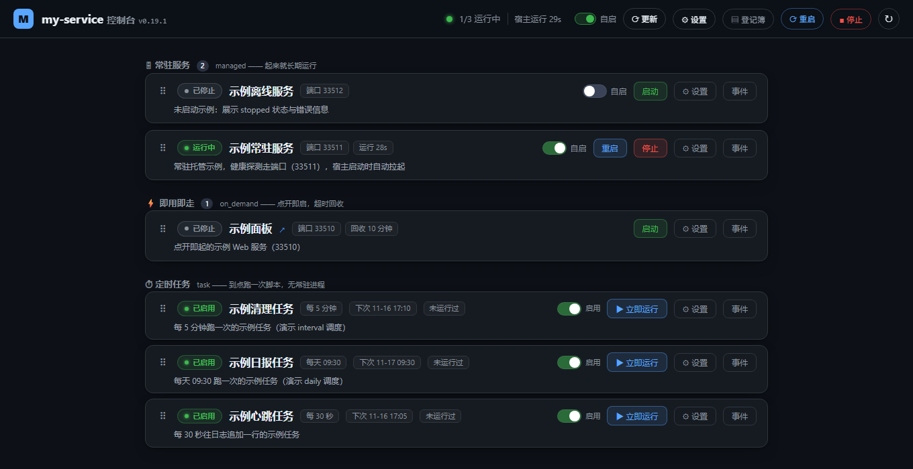

# my-service

[](https://github.com/keeyangyy/my-service/releases)
[](LICENSE)
[](https://www.python.org/)

Windows 本机服务编排器。以声明式注册条纳管本地服务，提供统一的启动与停止、健康探测、
开机自启、定时调度与结构化审计；控制面为单页 Web 面板，只监听回环地址。



## 特性

- **声明式接入**：`reg/services/<name>.json` 描述路径、启停方式与健康判定，写入即生效，无需重启宿主。
- **四种托管形态**：`managed` 全生命周期托管、`detached` 只观测、`on_demand` 按需启动并空闲回收、
  `task` 定时执行。
- **状态收敛**：健康探测结果按状态机收敛为明确状态，不会停留在中间态；端口被他人占用时保守告警。
- **定时调度**：`reg/tasks/<name>.json` 声明 `daily` / `interval` 计划，支持超时保护与错过补跑。
- **事件审计**：所有启停与调度写入结构化日志 `data/logs/host.jsonl`，面板内可直接检索。
- **零第三方依赖**：仅使用 Python 标准库与原生 JavaScript，不引入运行时包管理器。

## 系统要求

| 项目 | 要求 |
|:--|:--|
| 操作系统 | Windows 10 / 11 |
| Python | 3.10 及以上（需在 `PATH` 中） |
| PowerShell | 7（推荐，脚本以 `pwsh` 验证） |

## 安装

### 发行包（推荐）

1. 从 [Releases](https://github.com/keeyangyy/my-service/releases/latest) 下载 `my-service-<version>.zip`。
2. 解压至任意非受保护目录，例如 `C:/path/to/my-service`。
3. 启动宿主：在 `run/` 目录右键 `start.ps1`，选择「使用 PowerShell 运行」；
   或在终端执行 `pwsh -File run/start.ps1`。
4. 访问 <http://127.0.0.1:1236>。首次启动会在 `run/` 下生成 `Dashboard.url`，后续可双击打开面板。

停止宿主：`pwsh -File run/stop.ps1`。安装开机自启：`pwsh -File run/install_autostart.ps1`，
与面板顶部「自启」开关等价。

### 源码

```powershell
git clone https://github.com/keeyangyy/my-service.git
cd my-service
pwsh -File ./run/start.ps1
```

源码工作区也可以一键升级：走发行包替换（`src/ web/ run/ docs/` + 三个文档），升级后工作区与 git 不一致，可用 `git checkout .` 恢复；想保留 git 历史时优先 `git pull`。

## 快速开始

接入一个已有服务需要三个前置条件：**启动入口**、**停止方式**、**健康判定**。

在 `reg/services/` 下创建注册条：

```json
{
  "path": "C:/path/to/your-service",
  "display": "your-service",
  "description": "示例：带网页面板的本机服务",
  "mode": "on_demand",
  "url": "http://127.0.0.1:33510/",
  "start": { "entry": "src/server.py" },
  "stop": { "script": "run/stop.ps1" },
  "health": { "type": "http", "url": "http://127.0.0.1:33510/health", "timeout_sec": 30 },
  "identity": { "pidfile": "data/server.pid" },
  "runtime": { "enabled": true, "autostart": false, "idle_timeout_sec": 600 }
}
```

注册条写入后刷新面板即可生效。完整字段说明见
[注册条协议](https://github.com/keeyangyy/my-service/blob/master/docs/design/registry.md)。

## 使用

### Web 面板

| 区域 | 功能 |
|:--|:--|
| 顶部栏 | 开机自启开关、检查更新、编排器设置、事件登记簿、重启宿主、停止宿主 |
| 服务卡片 | 状态、启动 / 停止、设置（空闲回收时长、关联任务）、事件；点击卡片打开服务页面 |
| 定时任务 | 启用开关、立即运行、设置（时刻 / 间隔 / 超时 / 补跑）、事件 |
| 分组 | 常驻服务与按需服务分组展示，支持拖拽排序并持久化 |

### 定时任务

在 `reg/tasks/<name>.json` 中声明调度计划，协议与语义见
[定时任务设计](https://github.com/keeyangyy/my-service/blob/master/docs/design/cron.md)。
面板支持行内修改时刻与间隔，并展示上次执行结果。

### 命令行

```powershell
./src/svc.ps1 ls                    # 服务列表与状态
./src/svc.ps1 start <name>          # 启动指定服务
./src/svc.ps1 stop <name>           # 停止指定服务
./src/svc.ps1 crons                 # 定时任务列表
./src/svc.ps1 cron-run <name>       # 立即执行一次任务
./src/svc.ps1 events [name] [n]     # 查看启停登记簿
```

## 配置

`config.json` 是可选文件：不存在时使用内置默认值（`host` / `port` 等）；面板「设置」修改后立即生效，并自动创建/写回该文件。

| 字段 | 默认值 | 说明 |
|:--|:--|:--|
| `host` / `port` | `127.0.0.1` / `1236` | 控制面监听地址与端口 |
| `reg_dir` | `reg` | 注册条根目录 |
| `audit_retention_days` | `7` | 事件保留天数，`0` 表示不清理 |
| `cors_local_only` | `true` | 仅向本机来源网页授予跨源权限 |
| `cors_allow` | `[]` | 额外放行的跨源来源（主机名 / IP / CIDR），局域网访问时用 |
| `monitor.fast_sec` / `idle_sec` / `panel_grace_sec` | `1` / `10` / `15` | 状态轮询间隔与面板活跃宽限 |
| `scheduler.tick_sec` | `10` | 调度器检查间隔 |
| `backup.keep` | `7` | `data/bak/` 保留份数，`0` 表示不自动清理 |

数据目录默认位于包根 `data/`；设置环境变量 `MY_SERVICE_HOME` 可指定其他位置。

## 目录结构

```
my-service/
├── config.json                # 控制面与保留策略配置
├── reg/
│   ├── services/<name>.json   # 服务注册条（唯一发现源）
│   └── tasks/<name>.json      # 定时任务注册条
├── adapters/                  # 可选转接层，按服务名自动优先命中
├── run/                       # 人工入口：start / stop / restart / 自启安装与卸载
├── data/                      # 运行时数据：logs / bak / update / pids
├── src/
│   ├── server.py              # 装配入口（config → Scanner → Manager → Scheduler → HTTP）
│   ├── service_cli.py         # 唯一 CLI 实现（宿主生命周期 + 服务管理）
│   ├── svc.ps1                # 服务管理薄壳（转调 service_cli.py）
│   └── core/                  # api / state / scheduler / runner / scanner / audit / backup
├── web/                       # 面板静态资源
├── tools/
│   ├── build-portable.ps1     # 发行包构建
│   └── check_privacy.ps1      # 发布前隐私检查
├── examples/                  # 示例注册条与可运行 demo
├── tests/                     # 单元测试
└── docs/                      # 文档（guide 面向使用者，design 面向开发者）
```

## 升级与回滚

面板顶部「⟳ 更新」检查新版本，确认后自动下载、替换 `src/`、`web/`、`run/`、`docs/` 与
`README.md`、`CHANGELOG.md`、`LICENSE`，随后重启宿主。`reg/`、`data/`、`config.json` 不受影响；
替换前的代码保留在 `data/bak/code-prev/`，可手工回滚。

## 安全模型

默认只绑定回环地址、只向本机来源网页授予跨源权限，不提供账户体系。这一取舍的前提是「本机进程
本身即可调用接口」。

**要在局域网里用**（例如装在常开的机器上、从笔记本访问面板），需要同时做两件事：

1. `config.json` 的 `host` 改为 `0.0.0.0`（或具体网卡地址）；
2. `cors_allow` 列出允许的来源，例如 `["c675-wjy", "100.64.0.0/10"]`，支持主机名、精确 IP 与 CIDR。

注意 CORS 只约束浏览器跨源，**不约束 curl / 脚本**——任何能连到端口的设备都能直接调接口。
所以真正的边界是网络层：建议用防火墙只放行 Tailscale 或局域网网段。威胁模型与漏洞报告方式见
[SECURITY.md](https://github.com/keeyangyy/my-service/blob/master/SECURITY.md)。

## 开发

```powershell
python -m unittest discover -s tests    # 全量单元测试
python -m ruff check src tests          # 静态检查（ruff 0.17.5）
pwsh -File ./tools/check_privacy.ps1    # 发布前隐私检查
```

示例环境：`pwsh -File ./examples/demo/start-demo.ps1` 会在临时目录以独立端口 1246 启动实例，
不影响现有数据；`-Stop` 停止并清理。

代码约定与提交规范见 [CONTRIBUTING.md](https://github.com/keeyangyy/my-service/blob/master/CONTRIBUTING.md)，
架构与设计文档见 [docs/architecture.md](https://github.com/keeyangyy/my-service/blob/master/docs/architecture.md)。

## 许可证

[MIT](LICENSE)
